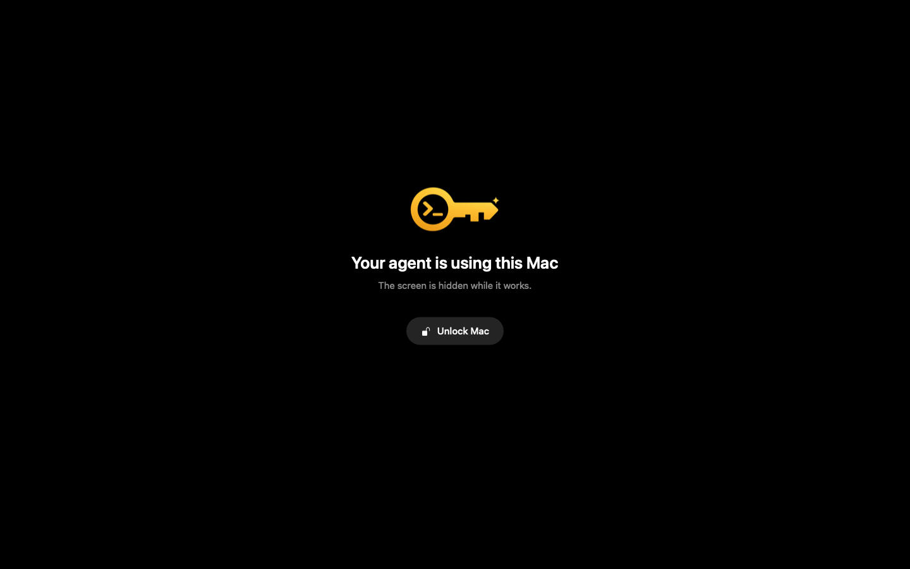

# Sparekey

A macOS CLI that lets an AI agent unlock your logged-in session and relock it after a task.

[](LICENSE)

English · [한국어](README.ko.md) · [日本語](README.ja.md) · [简体中文](README.zh-CN.md) · [Español](README.es.md)



## Features

- Unlocks your own logged-in session with a password stored in your login Keychain.
- Verifies the console account and lock-screen password field before submitting the password at most once per attempt.
- Covers physical displays by default while allowing agent input and screen capture underneath.
- Keeps the display awake for up to 60 minutes, ending the hold on relock or authenticated takeover.
- Returns a task token for relocking, with revocation when the user takes control.
- Includes standalone skills for Codex and Claude Code, and JSON output for scripts.

Sparekey depends on the lock screen's Accessibility layout. The package targets macOS 13 and later; that deployment target does not establish runtime compatibility with every macOS release.

## Requirements

- macOS 13 or later with your own desktop session already logged in.
- Xcode Command Line Tools with Swift 5.9 or later to build from source, including the Homebrew formula's source build.
- A local interactive terminal on the unlocked Mac for setup and uninstall. Run as your regular user, without `sudo`.
- Accessibility permission for the installed helper and access to your login Keychain.
- Homebrew if you use the Homebrew installation method.

An Apple Developer account is not required. Sparekey cannot unlock FileVault at startup, log in a logged-out user, or unlock another account. It does not provide remote access.

## Installation

With Homebrew:

```sh
brew install yoonpooh/tap/sparekey
```

Or build from this repository:

```sh
git clone https://github.com/yoonpooh/sparekey.git
cd sparekey
swift build -c release
.build/release/sparekey setup --skill codex
```

Setup installs a signed helper at `~/Library/Application Support/sparekey/bin/sparekey`.
For a source installation, add that binary's directory to your `PATH`, or create a link in a directory already on your `PATH`:

```sh
mkdir -p "$HOME/.local/bin"
ln -s "$HOME/Library/Application Support/sparekey/bin/sparekey" "$HOME/.local/bin/sparekey"
```

The link command requires that its destination does not already exist. Ensure `~/.local/bin` is on your shell's `PATH` before using `sparekey` by name.

The [Homebrew formula in this repository](packaging/homebrew/sparekey.rb) is a packaging template with a placeholder release checksum. Do not install that local file as a release formula.

## Quick start

For a Homebrew installation, run setup in your own local terminal while the Mac is unlocked:

```sh
sparekey setup --skill codex
```

Choose `--skill claude`, `--skill claude,codex`, or `--no-skill` as appropriate. Without either selection option, setup asks which skills to install.
Setup creates or reuses a local signing identity, signs the helper, saves the login password when needed, and starts a per-user LaunchAgent.
Enter your password only at the hidden terminal prompts. If macOS asks to use the signing key, choose **Allow**, not **Always Allow**.
Follow setup's instructions to enable Accessibility for the helper.

Check the installation and current state:

```sh
sparekey doctor
sparekey status --json
```

The installed skill guides the agent through status, probe, unlock, and cleanup. Start a new agent conversation after installing or updating a skill.
For a manual task on a locked Mac:

```sh
sparekey probe --json
sparekey unlock --json
```

Check each result before continuing. `probe` wakes the display and verifies the login field without reading or submitting the password. A wake during the password grace period can return `state: "unlocked"` with a `lockToken`; in that case, retain that token and skip `unlock`.
Otherwise, a successful unlock can return the token. Keep it private and use the returned value for task cleanup:

```sh
sparekey lock --lock-token "$TASK_LOCK_TOKEN" --json
```

`TASK_LOCK_TOKEN` above is a placeholder shell variable for the returned token, not a setting read by Sparekey. Do not relock a session you found already unlocked unless this task has valid relock authority.
On `relock_revoked`, leave the Mac as it is. Never use `--force` to bypass task cleanup restrictions.

## Configuration

Configuration uses CLI options rather than a user configuration file. See the [CLI reference](docs/CLI.md) for all public commands and options.

| Item | Location or option |
| --- | --- |
| Signed helper | `~/Library/Application Support/sparekey/bin/sparekey` |
| LaunchAgent | `~/Library/LaunchAgents/io.github.yoonpooh.sparekey.helper.plist` |
| Runtime socket | `~/Library/Application Support/sparekey/run/control.sock` |
| Safety state | `~/Library/Application Support/sparekey/state.json` |
| Codex skill | `~/.agents/skills/sparekey/SKILL.md` |
| Claude Code skill | `~/.claude/skills/sparekey/SKILL.md` |
| Existing signing identity | `setup --identity NAME` |
| Replace saved password | `setup --reset-password` |
| Disable the default cover for one unlock | `unlock --no-cover` |

Install a skill later with `sparekey skill install --agent codex` or `--agent claude`.
Customized skills require confirmation or `--force`; replacement creates `SKILL.md.bak` and refuses to overwrite an existing backup.
Migration of a legacy Sparekey plugin requires Codex CLI and verifies removal before writing the standalone skill. Fresh installations do not require Codex CLI.

### Upgrade and uninstall

After `brew upgrade sparekey` or rebuilding the binary, run `sparekey setup` locally to refresh the signed helper and skills. Setup reuses the saved credential when it remains readable.

Run `sparekey uninstall` from a local interactive terminal to remove the helper, saved credential, LaunchAgent, runtime files, and matching Sparekey-written skills.
It keeps the signing identity, the Accessibility entry, customized skills, and any link you created in `~/.local/bin`. Remove those separately if needed. A Homebrew-installed CLI also remains until you remove its formula.

## CLI reference

```sh
sparekey --help
sparekey help unlock
sparekey --version
```

The [CLI reference](docs/CLI.md) lists exact command syntax, accepted options, JSON fields, exit codes, and relock rules. Running `sparekey` without arguments shows help.

## How it works

The CLI sends requests over a private Unix socket to a signed helper running as your user through launchd. Both ends check the peer's user ID.
The helper checks the console session, Apple-signed `loginwindow`, account label, and secure password field before reading the saved password from the login Keychain.
It submits at most once per attempt. A persistent 30-second limiter and a circuit breaker restrict further attempts after an unconfirmed submission.

The default cover is placed beneath the lock screen before password submission. **Unlock Mac** requires fresh macOS authentication to reveal the display and revoke task relock authority.
Tokens also expire when the hold ends, a system lock event occurs, or the helper restarts. The 60-minute limit ends the display hold; it is not a scheduled lock command.

See [design notes](docs/DESIGN.md) and the [agent skill](skills/sparekey/SKILL.md) for implementation details and the agent workflow.

## Security notes

Read the [security policy](SECURITY.md) before installation.

- Any process running as your user can ask the helper to unlock. Use a trusted personal account.
- The cover hides physical displays; it does not lock the Mac or prevent blind physical input. Screen captures omit it.
- Sparekey listens on a local socket, not the network. It cannot protect against malware already running as you.
- Never put a login password in chat, command arguments, environment variables, or documentation. Keep task tokens out of logs and saved reports.
- Do not loop failed unlocks or bypass account and field verification. Report vulnerabilities privately as described in the security policy.

## Troubleshooting

Start with `sparekey doctor`. It checks installation and permissions, not whether the current lock-screen layout can be unlocked.

| Result | Action |
| --- | --- |
| `not_set_up`, `helper_not_running`, `helper_version_mismatch` | Run `sparekey setup` in a local terminal. |
| `accessibility_missing` | Enable the installed helper under System Settings > Privacy & Security > Accessibility, then rerun setup. |
| `credential_unavailable` | Rerun setup locally and enter the password if prompted. |
| `breaker_tripped`, `unlock_not_confirmed` | Stop attempts. If the saved password is stale, run `sparekey setup --reset-password` locally. |
| `rate_limited` | Attempts are limited to one per 30 seconds. Do not retry in a loop. |
| `login_account_mismatch` | Stop. The visible account label does not match the current user. |
| `login_window_unsupported`, `field_not_ready` | Inspect the specific error and lock-screen state. Do not type into an unverified field. |
| `relock_revoked` | Leave the current state unchanged. Do not fall back to `lock --force`. |
| `display_sleep_not_confirmed` | Locking may have succeeded even though display sleep was not confirmed. Read `status` before deciding what to do next. |

Sparekey selects the unique login window and ignores only explicitly empty, nonmodal auxiliary windows with no AX actions. Unknown or interactive extra windows still block unlock. Layout errors include bounded AX metadata without reading window titles or password values. They do not identify the cause as Force Quit Applications, and the helper never closes windows. The [agent skill](skills/sparekey/SKILL.md) describes the narrowly scoped dialog recovery and the native macOS CUA API to inspect it. A failed probe does not mean a password was submitted.

## Development

From the repository root:

```sh
swift build
swift test
swift build -c release
python3 scripts/embed-agent-assets.py --check
```

`Package.swift` defines the `sparekey` executable, `SparekeyCore` library target, and core and transport test targets.
The embedded asset check detects drift between the agent skill and its generated Swift file.

Additional tools have their own instructions:

- [Shimmer renderer](scripts/render-shimmer/README.md) produces offscreen artwork and animation frames without operating the helper.
- [Local signing spike](scripts/spike/README.md) tests signing, Accessibility, and Keychain behavior. It changes local Keychain and LaunchAgent state, so run it only deliberately.

See the [changelog](CHANGELOG.md) for release history. The lock-screen interaction approach was informed by [Cindy](https://github.com/makecindy/cindy); Sparekey is an independent implementation.

## License

[MIT](LICENSE), copyright yoonpooh.
